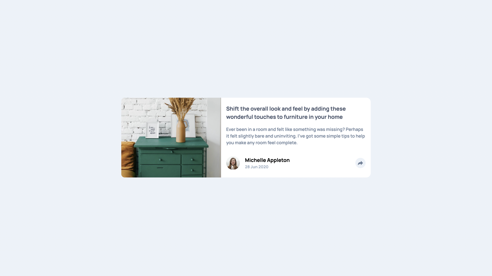

# Frontend Mentor - Article preview component solution

This is a solution to the [Article preview component challenge on Frontend Mentor](https://www.frontendmentor.io/challenges/article-preview-component-dYBN_pYFT). Frontend Mentor challenges help you improve your coding skills by building realistic projects. 

## Table of contents

- [Overview](#overview)
  - [The challenge](#the-challenge)
  - [Screenshot](#screenshot)
  - [Links](#links)
- [My process](#my-process)
  - [Built with](#built-with)
  - [What I learned](#what-i-learned)
  - [AI Collaboration](#ai-collaboration)
- [Author](#author)
- [Acknowledgments](#acknowledgments)

## Overview

### The challenge

Users should be able to:

- View the optimal layout for the component depending on their device's screen size
- See the social media share links when they click the share icon

### Screenshot



### Links

- Solution URL: [Add solution URL here](https://your-solution-url.com)
- Live Site URL: [Add live site URL here](https://your-live-site-url.com)

## My process

### Built with

- Semantic HTML5 markup
- CSS custom properties
- Flexbox
- Mobile-first workflow
- Vanilla JavaScript


### What I learned

I learned how to toggle a share popup using JavaScript by adding and removing a class.

```js
shareBtn.addEventListener('click', () => {
  socials.classList.toggle('socials--active');
  author.classList.toggle('author--hidden');
});
```

### AI Collaboration

I used an AI assistant to help debug CSS layout issues and clarify JavaScript event handling. It was useful for quick feedback, but I wrote and tested the final code myself.

## Author

- Github - [Ehicodes](https://github.com/Ehicodes)
- Frontend Mentor - [@Ehicodes](https://www.frontendmentor.io/profile/@Ehicodes)
- X - [@Ehinomen_01](https://x.com/Ehinomen_01)

## Acknowledgments

Thanks to Frontend Mentor for the challenge and design.

